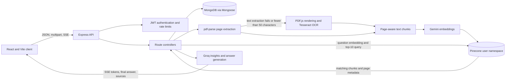

# PrepGenius-AI

PrepGenius-AI is a document-grounded interview preparation assistant. Learners upload study PDFs, ask questions in conversations, and receive streamed answers with page references to retrieved passages.

## Features

- Account registration and login with bcrypt password hashing and seven-day JWTs.
- Protected dashboard route and authenticated API requests.
- PDF upload with extension and signature checks, a 100 MiB file-size limit, and a 500-page processing limit.
- Page-aware text extraction, with English OCR fallback for scanned PDFs or when text extraction fails.
- Page-preserving text chunking and Gemini embedding generation.
- Pinecone semantic vector retrieval in a namespace for each authenticated user. Retrieval filters matches to that user's ready documents and uses a similarity threshold.
- Groq-generated answers streamed over Server-Sent Events (SSE), with retrieved source text and page citations.
- MongoDB-backed conversations and message history, including up to three completed prior turns in the generation prompt.
- Optional Groq-generated document summary and three suggested questions. Insight generation failure does not block an otherwise successful upload.
- Document processing states and failure messages in the dashboard.

Search is semantic vector search. The current implementation does not include keyword or hybrid search.

## Architecture



### Request and data flow

1. The authenticated client uploads a multipart PDF using the `pdf` field.
2. Multer stores it temporarily in `server/uploads/`, subject to the size limit. The backend checks the `.pdf` filename extension and looks for `%PDF-` in the first 1,024 bytes.
3. `pdf-parse` extracts text per page. If extraction throws or total extracted text is under 50 characters, the controller attempts OCR. PDF.js renders pages and Tesseract recognizes them sequentially in English.
4. Each page is cleaned and chunked independently (1,000-character chunk size and 200-character overlap), retaining page numbers.
5. Gemini's `gemini-embedding-001` model creates an embedding for each chunk. The backend creates a MongoDB document record with status `processing`, then upserts vectors with text, page, filename, user, and document metadata to the user's Pinecone namespace.
6. After a successful upsert, the MongoDB document becomes `ready`. On a caught processing failure, the backend attempts vector cleanup and records a `failed` state. The temporary upload is removed in the controller's `finally` block.
7. For chat, the backend verifies conversation ownership, embeds the question, queries the authenticated user's Pinecone namespace for up to 10 matches, filters by `SIMILARITY_THRESHOLD`, and excludes vectors that do not belong to a ready document (or a legacy document without `processingStatus`).
8. Groq receives the retrieved context and bounded conversation history. The server emits SSE `token` events followed by a `done` event containing the final answer and source references. Provider or persistence failures return a safe JSON or SSE error.

The model is instructed to cite document claims using `[Page N]`. The application returns retrieved source text, filename, page, and similarity score, but it does not independently validate every citation in generated prose.

## Technology

| Area | Implementation |
|---|---|
| Client | React, React Router, Vite, Tailwind CSS, Axios, browser `fetch` for SSE |
| API | Node.js, Express 5, Multer |
| Persistence | MongoDB and Mongoose |
| Authentication | bcrypt and JSON Web Tokens |
| PDF and OCR | `pdf-parse`, `pdfjs-dist`, `@napi-rs/canvas`, Tesseract.js |
| Embeddings | Google GenAI SDK, Gemini `gemini-embedding-001` |
| Vector search | Pinecone SDK |
| Generation | Groq SDK for answers, summaries, and suggested questions |
| Tests | Node's built-in test runner; controller/provider paths are mocked where appropriate |

## Authentication and ownership

Registration stores a bcrypt password hash. Login returns a JWT valid for seven days; the client stores it in `localStorage` and adds it to API requests as a Bearer token. The dashboard route checks for a stored token, while protected API routes independently verify the JWT.

Document and conversation queries are scoped to the authenticated user. Messages are accessed through a conversation that has first passed its ownership check. Pinecone queries, upserts, and deletions use the authenticated user's namespace. These server checks are the security boundary; the client-side route check alone is not authorization.

Rate limits are currently stored in process memory:

| Route group | Limit | Key |
|---|---:|---|
| Registration and login (combined bucket) | 20 per 15 minutes | Client IP |
| PDF upload | 10 per hour | Client IP plus authenticated user ID |
| Chat message submission | 60 per hour | Client IP plus authenticated user ID |
| Conversation create, rename, and delete | 30 per hour | Client IP plus authenticated user ID |

The limits reset with the process and are not shared between server instances. For deployments with multiple instances, a shared rate-limit store is needed for consistent enforcement. The Express app trusts no proxy by default. If the service is behind a known reverse-proxy chain, set `TRUST_PROXY_HOPS` to its actual trusted hop count; do not set it based on an unverified proxy topology.

## Document processing states and failures

Documents use `processing`, `ready`, and `failed` states. New uploads become `processing` after text extraction and embedding generation, before Pinecone upsert. Successful upsert changes the state to `ready`. Caught upload failures attempt to delete partial vectors and mark the record `failed`; retrieval ignores failed and processing documents. The dashboard allows failed records to be deleted and uploaded again.

Deletion marks a document non-retrievable before attempting Pinecone vector deletion. If vector cleanup or MongoDB deletion fails, the record remains available for a deletion retry where MongoDB is reachable. These are best-effort recovery paths, not a distributed transaction. A process crash or ambiguous provider/database timeout can still require operational reconciliation.

Multer removes partial files for upload middleware errors, signature rejection removes the uploaded file, and controller processing removes the temporary file in `finally`. Existing files left in the upload directory by an earlier process are not automatically reconciled. The uploaded PDF is not retained as durable document storage by the normal processing flow; the searchable content is in Pinecone and the app metadata is in MongoDB.

## Repository structure

```text
PrepGenius-AI/
├── client/
│   ├── package.json
│   ├── vite.config.js
│   └── src/
│       ├── App.jsx, main.jsx
│       ├── pages/                 # Login, Register, Dashboard
│       ├── components/
│       │   ├── chat/              # Chat, SSE UI, messages, sources
│       │   ├── common/            # Sidebar, navbar, modal
│       │   ├── dashboard/         # Upload, documents, statistics
│       │   └── layout/
│       └── services/              # API, chat, and dashboard requests
├── server/
│   ├── package.json
│   ├── server.js, app.js
│   ├── config/                    # MongoDB, Gemini, Groq, Pinecone
│   ├── controllers/               # Auth, chat, documents, dashboard
│   ├── middleware/                # JWT auth, upload validation, rate limits
│   ├── models/                    # User, Document, Conversation, Message
│   ├── rag/                       # PDF extraction and text chunking
│   ├── routes/                    # Auth, chat, documents, dashboard
│   ├── services/                  # OCR, embeddings, vector search, generation
│   ├── test/                      # Automated tests
│   └── uploads/                   # Temporary upload destination
├── postman/                       # Postman collections and request artifacts
├── .gitignore
└── README.md
```

## Prerequisites

- Node.js and npm versions compatible with the checked-in package dependencies. The manifests do not pin a Node version.
- A MongoDB connection, a Pinecone index configured compatibly with the embedding model, a Gemini API key, and a Groq API key for the corresponding features.
- A writable backend `server/uploads/` directory. Start the server with `server/` as its working directory because Multer's upload destination is relative (`uploads/`).

There are no checked-in `.env.example` files. Create `server/.env` and `client/.env` as described below; keep credentials in those ignored files or a secrets manager. Never paste real values into this README or commit environment files.

## Environment variables

Backend variables belong in `server/.env` (or the backend hosting environment). Frontend variables belong in `client/.env` and are read by Vite at build time.

| Variable | Location | Purpose |
|---|---|---|
| `MONGO_URI` | Backend | MongoDB connection string. |
| `JWT_SECRET` | Backend | Signs and verifies JWTs. Use a strong, private value. |
| `GEMINI_API_KEY` | Backend | Gemini embedding access. |
| `PINECONE_API_KEY` | Backend | Pinecone authentication. |
| `PINECONE_INDEX` | Backend | Pinecone index name. |
| `GROQ_API_KEY` | Backend | Groq answer and document-insight requests. |
| `PORT` | Backend | HTTP listening port; defaults to `5000`. |
| `GROQ_CHAT_MODEL` | Backend, optional | Overrides the chat generation model; default is `openai/gpt-oss-20b`. |
| `GROQ_SUMMARY_MODEL` | Backend, optional | Overrides the document insights model; default is `openai/gpt-oss-20b`. |
| `SIMILARITY_THRESHOLD` | Backend, optional | Minimum Pinecone match score; effective fallback is `0.35` when unset or falsy. |
| `TRUST_PROXY_HOPS` | Backend, optional | Positive integer number of trusted proxy hops; default is no trusted proxy. Configure only for a verified deployment topology. |
| `VITE_API_URL` | Frontend | Backend origin/base URL. For Vercel set `https://prepgenius-ai-9146.onrender.com`; the client appends `/api` and removes a supplied trailing `/api` to prevent duplication. |

Vite variables are embedded in the built client and must not contain secrets. The API keys and JWT secret belong only on the backend.

### Safe local environment setup

Create local files that are ignored by Git and fill them with credentials from your own service accounts. For example, use the variable names below with private values; this is a template, not a checked-in `.env` file:

```dotenv
# server/.env
PORT=5000
MONGO_URI=<your-mongodb-connection-string>
JWT_SECRET=<a-long-random-secret>
GEMINI_API_KEY=<your-gemini-key>
PINECONE_API_KEY=<your-pinecone-key>
PINECONE_INDEX=<your-index-name>
GROQ_API_KEY=<your-groq-key>
# Optional:
# GROQ_CHAT_MODEL=<model-name>
# GROQ_SUMMARY_MODEL=<model-name>
# SIMILARITY_THRESHOLD=0.35
# TRUST_PROXY_HOPS=1
```

```dotenv
# client/.env
VITE_API_URL=http://localhost:5000
```

The root `.gitignore` excludes `.env` files, dependency directories, build outputs, logs, and uploaded files under `server/uploads/`. Verify `git status --short` before committing, especially if adding new environment or generated files.

### MongoDB and Pinecone setup

- `MONGO_URI` must be a valid MongoDB connection URI for a database reachable by the backend. For MongoDB Atlas, allow the backend's network address and use a database user with appropriate database access. The server waits for this connection before listening and exits if it cannot connect.
- Create a dense Pinecone index and set `PINECONE_INDEX` to its name. The `gemini-embedding-001` request omits an output dimension, so it uses the 3,072-dimensional default; the index dimension must match. Configure cosine similarity, which is the expected metric for the score threshold and search behavior described here. The Pinecone API key must be allowed to access that index. The app creates user namespaces in the index; no per-user index setup is needed.
- Keep `GEMINI_API_KEY`, `PINECONE_API_KEY`, and `GROQ_API_KEY` on the backend only. The client only needs the backend URL.

## Local installation and run

Install and start the backend in one terminal:

```bash
cd server
npm install
npm run dev
```

`npm run dev` uses Nodemon. For a normal Node start, use `npm start`. The backend awaits MongoDB connection before listening.

Install and start the frontend in another terminal:

```bash
cd client
npm install
npm run dev
```

Open the local URL printed by Vite. Register, log in, create a conversation, upload a PDF, and ask a question. The backend must be reachable at `VITE_API_URL`.

## Tests, lint, and build

Run the automated server tests from `server/`:

```bash
npm test
```

The suite uses mocked models, filesystem operations, and provider services for controller and route failure paths. It does not establish that live MongoDB, Pinecone, PDF rendering/OCR, Gemini, or Groq integrations work in a deployed environment.

Run client lint and production build from `client/`:

```bash
npm run lint
npm run build
```

The server package currently defines `start`, `dev`, and `test`; it does not define a separate lint or build script. `server/test.js` is a separate Gemini connectivity probe that makes a provider request when run with `node test.js`; it is not part of `npm test`.

## Troubleshooting

| Symptom | Checks |
|---|---|
| Login or other API request fails to connect | Confirm the backend is running and `VITE_API_URL` in `client/.env` is the backend origin. Local `client/.env` can point to `http://localhost:5000`; an unset value defaults to the Render origin. Restart Vite after changing the file. |
| API URL contains `/api/api` | Remove `/api` from `VITE_API_URL`; the client appends it. |
| Login succeeds but protected requests return 401 | Sign in again, confirm the browser has a current token, and confirm `JWT_SECRET` is set consistently on the backend. Tokens expire after seven days. |
| Server exits before listening | Check that `MONGO_URI` is valid, the database is running/reachable, and (for Atlas) the backend network is allowed. Startup waits for MongoDB. |
| Pinecone reports dimension or index errors | Check `PINECONE_INDEX` and that the index exists, is accessible to the key, and uses 3,072 dimensions with cosine metric. |
| PDF upload fails during OCR or PDF rendering | Install dependencies with `npm install` from `server/`, use a supported Node.js version, and check that PDF.js and `@napi-rs/canvas` can load in the current OS/runtime. OCR uses Tesseract.js English worker data and may require network access on its first initialization, depending on the runtime cache. |
| A `.pdf` file is rejected | The backend checks both the filename extension and for a `%PDF-` signature in the first 1,024 bytes; a renamed non-PDF will fail. |
| A scanned PDF takes a long time or has no usable text | OCR runs page by page in English when extraction fails or total extracted text is under 50 characters. Processing runs during the upload request, so large files may take time; the server log reports OCR page progress. |
| Chat returns the document fallback or no sources | Confirm the document is `ready`, processing produced vectors, the Pinecone index configuration matches the embedding dimension, and matches meet `SIMILARITY_THRESHOLD` (default `0.35`). Retrieval covers all ready documents in the user's namespace. |
| `npm` reports missing scripts | Run commands from the correct directory: backend scripts in `server/`, client lint/build scripts in `client/`. |

## API overview

All application API routes are mounted below `/api`. Except registration and login, routes require `Authorization: Bearer <JWT>`.

| Method | Endpoint | Auth | Description |
|---|---|---:|---|
| `GET` | `/` | No | Backend running response (outside the `/api` prefix). |
| `POST` | `/api/auth/register` | No | Create an account from `{ name, email, password }`. |
| `POST` | `/api/auth/login` | No | Authenticate with `{ email, password }`; returns a JWT. |
| `POST` | `/api/documents/upload` | Yes | Upload a PDF as multipart field `pdf`. |
| `GET` | `/api/documents` | Yes | List the authenticated user's documents. |
| `DELETE` | `/api/documents/:id` | Yes | Delete an owned document and its Pinecone vectors. |
| `GET` | `/api/dashboard/stats` | Yes | Return document, question, and vector counts plus `aiStatus`. |
| `POST` | `/api/chat/new` | Yes | Create a conversation. |
| `GET` | `/api/chat/conversations` | Yes | List the authenticated user's conversations. |
| `GET` | `/api/chat/:conversationId` | Yes | Read an owned conversation and its messages. |
| `POST` | `/api/chat/:conversationId` | Yes | Send `{ question }`; response is an SSE stream. |
| `PATCH` | `/api/chat/:conversationId` | Yes | Rename an owned conversation with `{ title }`. |
| `DELETE` | `/api/chat/:conversationId` | Yes | Delete an owned conversation and its messages. |

The dashboard controller currently returns `aiStatus: "Online"` as a fixed value; it is not a live provider health check. Chat streaming uses SSE events named `token`, `done`, and `error`.

## Deployment notes

The repository includes a Vercel SPA rewrite for the client. The following describes the application requirements; backend hosting commands and networking must be verified for the chosen platform.

Deployment-specific environment, networking, filesystem, proxy, CORS, and build configuration may differ from this local setup; verify the target platform's requirements before deployment.

- For Vercel, set the project Root Directory to `client`, Framework Preset to Vite, Build Command to `npm run build`, and Output Directory to `dist`. Set `VITE_API_URL` to `https://prepgenius-ai-9146.onrender.com` in the Vercel Project Settings for Production (and Preview if used), then redeploy because Vite embeds this value at build time. `client/vercel.json` rewrites frontend routes to `index.html` for React Router.
- Run the frontend build with `npm run build` from `client/`. The client defaults to the Render origin when `VITE_API_URL` is absent; local development can override it with `client/.env`.
- Run the backend from `server/` with `npm start`. Configure backend environment variables in the hosting provider's secret/environment settings, ensure the service can reach MongoDB, Pinecone, Gemini, and Groq, and provide a writable `uploads/` directory.
- Set `PORT` if the platform supplies a port. MongoDB connection is awaited before the server begins listening.
- If the backend is behind a reverse proxy, determine the actual trusted hop count before setting `TRUST_PROXY_HOPS`; this affects client IP detection used by rate limits.
- Current CORS setup is Express `cors()` with its defaults; no origin allowlist is configured in application code. Configure an appropriate production origin policy before exposing the API publicly.
- Rate limits are per Node process. Use shared storage if multiple backend instances must enforce a common quota.
- Production filesystem persistence, static SPA fallback, HTTPS termination, health checks, and platform-specific build/start commands are not configured in this repository and require verification for the target host.

## Current limitations and known risks

- Retrieval searches across all ready documents in a user's namespace; selecting one document does not narrow semantic retrieval.
- No keyword or hybrid retrieval, reranker, or independent citation validator is implemented.
- OCR is English-only and sequential. OCR occurs when total extracted text is below 50 characters or text parsing fails; the signature check is not full PDF structural validation or malware scanning.
- The upload limit is 100 MiB and the page limit is 500, but rendered page dimensions are not separately capped in the current PDF renderer.
- Embeddings are generated sequentially and the vector upsert is a single call. There is no background queue or automatic distributed transaction/reconciliation across MongoDB and Pinecone.
- Rate limiting is in-memory and per process. Configure proxy trust only for a known topology.
- JWTs are stored in browser `localStorage`; a successful XSS attack could expose them. There is no server-side token revocation endpoint.
- The dashboard's AI status is currently static, not a provider health signal.
- No platform-specific deployment setup or license file is present. Verify the license and deployment plan before publishing or hosting publicly.

## Future improvements

These are not implemented features:

- Add a shared rate-limit store and deployment-level health monitoring.
- Add automated reconciliation for stale `processing` records and orphaned vectors after crashes or ambiguous provider failures.
- Add PDF render-dimension limits, stronger structural validation, and upload retention cleanup for stale temporary files.
- Add per-document retrieval, retrieval evaluation, reranking, citation validation, or keyword/hybrid retrieval if product requirements call for them.
- Add background processing for large documents and clearer progress reporting.
- Review a production CORS allowlist and token storage strategy for the deployment threat model.

## Interview preparation use

A useful project walkthrough is to explain how the application keeps page metadata attached from PDF extraction through Pinecone retrieval and source cards; why scanned documents need a separate OCR path; how semantic retrieval supplies context to Groq; and how SSE lets the UI render answer tokens progressively. Be clear about the difference between implemented semantic retrieval and unimplemented keyword/hybrid search, and distinguish mocked automated tests from live provider verification.

## License

No `LICENSE` file is present in the repository. The project license is not specified.
